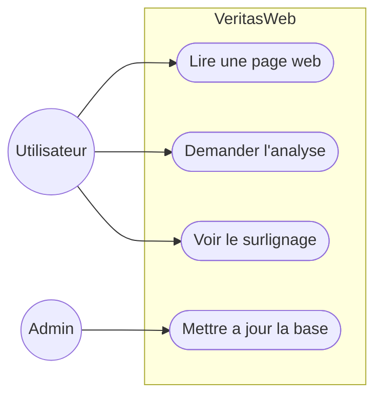
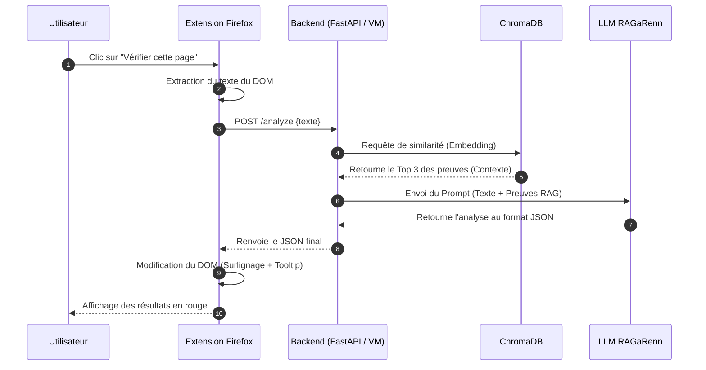
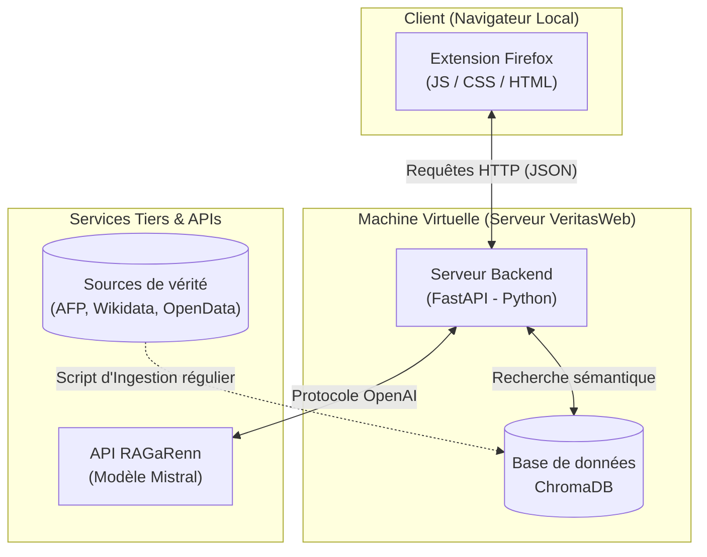

# Rapport de Projet : VeritasWeb

## 1. Présentation du Projet
**VeritasWeb** est une extension de navigateur (Firefox) conçue pour lutter contre la désinformation en temps réel. Son objectif est d'analyser le texte de la page web lue par l'utilisateur, de croiser ces informations avec une base de données de faits avérés (Fact-Checking), et de mettre en évidence visuellement les affirmations fausses ou trompeuses.

Le projet repose sur l'architecture **RAG (Retrieval-Augmented Generation)**, qui combine la recherche sémantique dans une base vectorielle locale avec la capacité d'analyse d'un modèle de langage (LLM).

---

## 2. Choix Technologiques

Pour garantir la performance, la confidentialité et l'intégration académique, nous avons privilégié des technologies légères et open source :

*   **Base de données vectorielle : ChromaDB**
    *   *Pourquoi :* Contrairement à Pinecone ou Milvus qui nécessitent une infrastructure cloud lourde, ChromaDB s'exécute localement dans un simple dossier (`veritas_vectordb`). C'est idéal pour un projet de cette taille.
*   **Modèle d'Embedding (Vectorisation) : `paraphrase-multilingual-MiniLM-L12-v2`**
    *   *Pourquoi :* Au lieu d'utiliser l'API payante d'OpenAI pour vectoriser le texte, nous utilisons ce modèle SentenceTransformers. Il est gratuit, tourne localement sur le processeur (CPU), et gère très bien le français et l'anglais.
*   **Intelligence Artificielle (LLM) : Mistral Small (via RAGaRenn)**
    *   *Pourquoi :* L'utilisation de l'infrastructure académique RAGaRenn (basée sur l'API compatible OpenAI) est gratuite et permet d'interroger un modèle français performant (Mistral) tout en garantissant la confidentialité des données.
*   **Backend / Serveur : Python + FastAPI (à venir)**
    *   *Pourquoi :* Python est incontournable pour manipuler des données et de l'IA (Pandas, ChromaDB). FastAPI permet d'envelopper cette logique dans un serveur web rapide et léger pour communiquer avec l'extension.
*   **Frontend : Extension Web**

---

## 3. Fonctionnement des Composants

Le système est divisé en deux grandes phases : l'ingestion (asynchrone) et l'analyse (en temps réel).

### A. Récupération des données (Le Script d'Ingestion)
Un script récupère des données de sources fiables :
1.  **Global Fact-Check :** Démentis récents via l'API Google FactCheck (AFP, Le Monde, Reuters).
2.  **Wikidata :** Faits structurés et absolus via des requêtes SPARQL.
3.  **OpenData (data.gouv.fr) :** Métadonnées officielles de l'État français.
4.  **Dataset LIAR :** Un corpus massif historique de fake news politiques.
Le texte extrait est haché en **MD5** (pour éviter les doublons), transformé en vecteurs mathématiques (Embeddings), puis sauvegardé dans ChromaDB.

### B. Le Moteur d'Analyse (Le RAG)
Lorsqu'un texte est soumis au backend, le système transforme la phrase suspecte en vecteur et calcule la **Distance de similarité (L2)** avec les 12 000 documents de ChromaDB. Il extrait le Top 3 des preuves les plus pertinentes mathématiquement.

### C. L'Appel LLM
Le backend assemble un prompt strict contenant les preuves récupérées par le RAG et le texte de l'utilisateur. Il demande au modèle Mistral d'analyser le texte *exclusivement* à l'une de ces preuves. Le LLM est contraint de répondre sous un format JSON strict (Score, Booléen, Explication, Citation).

### D. L'Extension Firefox et la Machine Virtuelle (VM)
*   **La Machine Virtuelle (Serveur) :** Le backend Python (FastAPI) et le dossier ChromaDB tourneront en permanence sur une VM de l'université. Elle expose une API.
*   **L'Extension :** 
---

## 4. Diagrammes UML
### 4.1 Diagramme de cas d'Utilisation

### 4.2 Diagramme de Séquence

### 4.3 Diagramme d'Architecture

## 5. Guide d'Installation et d'Exécution

Ce guide détaille les étapes nécessaires pour cloner, configurer et exécuter le projet VeritasWeb sur une machine locale.

### 5.1. Prérequis
- **Python 3.10 ou supérieur** installé sur votre machine.
- **Git** pour cloner le dépôt.

### 5.2. Installation des dépendances
Ouvrez un terminal dans le dossier racine du projet et installez les bibliothèques requises :

    pip install -r requirements.txt

### 5.3. Configuration de l'environnement
Pour des raisons de sécurité, les clés API du LLM ne sont pas stockées sur Git. Vous devez configurer votre environnement local :

1. Copiez le fichier d'exemple fourni :

    cp .env.example .env

2. Éditez le fichier `.env` avec vos identifiants RAGaRenn :

RAGARENN_API_URL=https://ragarenn.eskemm-numerique.fr/sso/ch@t/api/chat/completions

RAGARENN_API_KEY=votre_cle_api_secrete_ici

RAGARENN_MODEL=ilaas/mistral-small-4-119b

### 5.4. Initialisation : Construire la base vectorielle
**Cette étape est obligatoire au premier lancement** pour créer le dossier `veritas_vectordb` qui servira de cerveau au RAG.

Lancez le script d'orchestration :

    python 1_construire_base.py

*Note : Le script télécharge également le dataset LIAR. L'encodage des 12 000 documents prendra quelques minutes.*

### 5.5. Test : Lancer le moteur d'analyse
Une fois la base vectorielle remplie, vous pouvez tester le pipeline d'analyse complet (RAG + LLM) via le terminal :

    python 2_analyser_page.py

### 5.6. Lancement du Serveur Backend (FastAPI)
*(Cette section sera mise à jour une fois le serveur finalisé)*